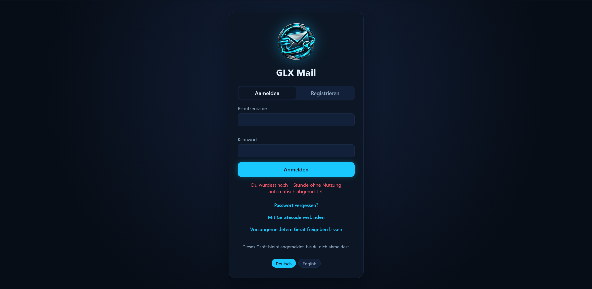
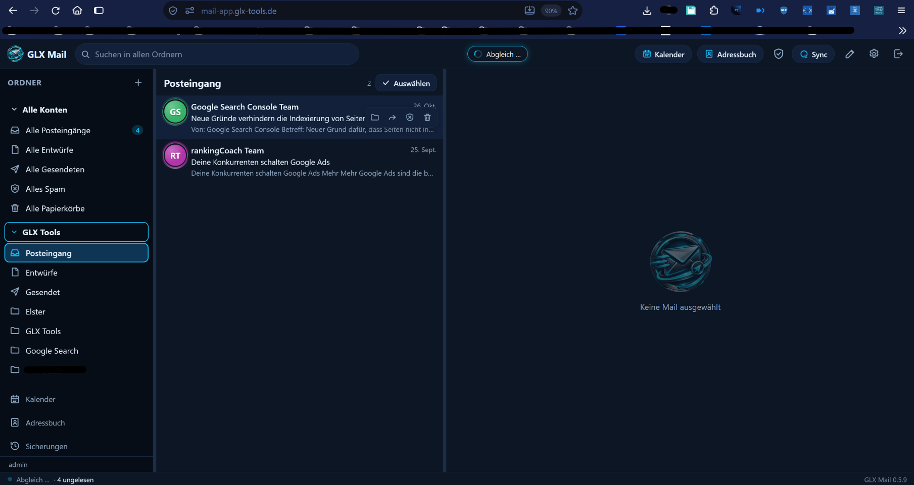
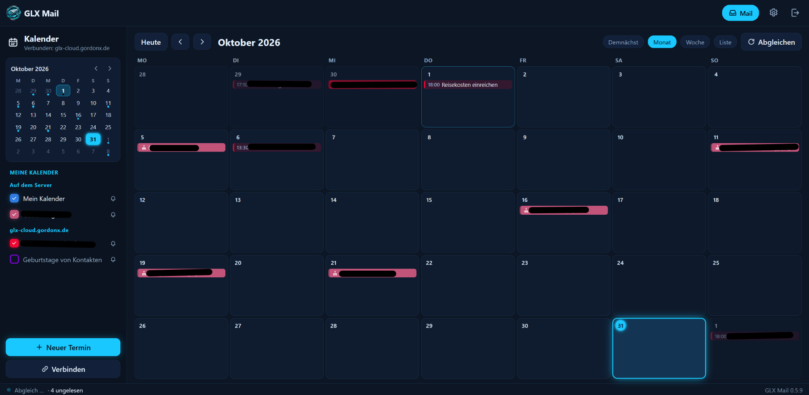

🌍 Sprachen: [🇺🇸 English](README.md) | [🇩🇪 Deutsch](README.de.md)

# 🖥️ GLX Mail Server

### Deine eigene GLX-Mail-Webanwendung auf deinem eigenen Server ☁️

*Die selbst gehostete GLX-Mail-Version für alle, die die Webanwendung auf einem eigenen Linux-Server betreiben möchten. Die Installation läuft wahlweise automatisiert über ein Windows-CMD-Werkzeug oder über eine PHP-Einrichtungsseite im Browser.* ⚡

---

## ⬇️ Produktinformationen & Lizenz

👉 **[GLX Tools – Shopübersicht](https://glx-tools.de/shopuebersicht/)** — aktuelle Produktinformationen und Lizenzmodelle.

GLX Mail Server richtet sich an Anwender mit einem eigenen Linux-Server, die die GLX-Mail-Webanwendung selbst installieren und betreiben möchten.

---

## 📸 Übersicht & Screenshots

### 1️⃣ Login Seite

### 1️⃣ Mail-Ansicht

  

### 2️⃣ Kalender-Ansicht

  

---

## ✨ Funktionen

- ☁️ **Selbst gehostet:** Installiere GLX Mail Server auf deinem eigenen Linux-Server.
- 📮 **Webbasierte Mail-Anwendung:** Rufe die GLX-Mail-Oberfläche über deinen Browser auf.
- 👥 **Adressbuch:** Verwalte deine Kontakte direkt in GLX Mail.
- 📅 **Kalender:** Verwende den integrierten Kalender und verwalte deine Termine.
- 🧰 **Automatischer Windows-Installer:** Ein Windows-CMD-Werkzeug führt durch die Installation und installiert die benötigten Serverkomponenten und Erweiterungen.
- 🌐 **Alternative Installation per Browser:** Lade die PHP-Einrichtungsseite und das ZIP-Paket auf deinen Server, öffne die PHP-Seite, trage Server- und Zugangsdaten ein und starte die geführte Installation.
- 📚 **Installationsanleitungen:** Beide Installationswege sind in der Auslieferung beschrieben.

---

## 🛠️ Installationsmöglichkeiten

Für GLX Mail Server gibt es zwei Installationswege:

### Variante A — Installation über Windows-CMD

Verwende das mitgelieferte Windows-CMD-Installationsprogramm. Es automatisiert die Installation von GLX Mail Server sowie der benötigten Serverkomponenten und Erweiterungen. Trage die abgefragten Serverdaten ein und folge den Installationsschritten.

### Variante B — PHP-Einrichtungsseite

1. Lade die mitgelieferte PHP-Einrichtungsseite auf deinen Server.
2. Lade das ZIP-Paket von GLX Mail Server in den dafür vorgesehenen Serverordner.
3. Öffne die PHP-Einrichtungsseite im Browser.
4. Trage die abgefragten Server- und Zugangsdaten ein.
5. Folge dem Einrichtungsassistenten, um GLX Mail Server auf deinem Server zu installieren.

Die genaue Ordnerstruktur, Voraussetzungen und Konfigurationsangaben für deine Serverumgebung stehen in der beiliegenden Installationsdokumentation.

---

## 🧾 Lizenzmodelle

GLX Mail Server wird mit einer zeitlich begrenzten Lizenz freigeschaltet. Wenn du den Dienst weiter nutzen möchtest, kaufst du die nächste Laufzeit bewusst neu:

- **Monatslizenz: 2,99 €** — wird für jeden Monat manuell neu gekauft.
- **Jahreslizenz: 30,00 €** — wird manuell für ein Jahr gekauft.
- Vor Ablauf der Lizenz wird eine Erinnerungs-E-Mail verschickt.
- Es gibt keine automatische Abo-Verlängerung. Der Kunde entscheidet selbst über den nächsten Kauf.

---

## 🔗 Mehr zu diesem Produkt

👉 **[GLX Tools – Shopübersicht](https://glx-tools.de/shopuebersicht/)** — Produktbeschreibung und Lizenzkauf.

Support: **info@glx-tools.de**

---

## 📄 License

Copyright © 2026 GLX Tools – Gordon Lehmann.
All rights reserved.

GLX Mail is proprietary commercial software.
No open-source license is granted.

The software may only be used under the
applicable license purchased through GLX Tools.

This repository contains product documentation
and screenshots. All rights to these materials
are reserved by their respective copyright holders.

GLX Mail Postfach is a hosted commercial service from GLX Tools. The applicable usage rights are defined by the license purchased through the GLX Tools shop. This repository provides product documentation and screenshots.

---

Mit ❤️ erstellt von **Dreamdancer100**

