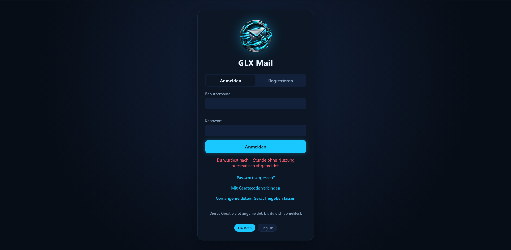
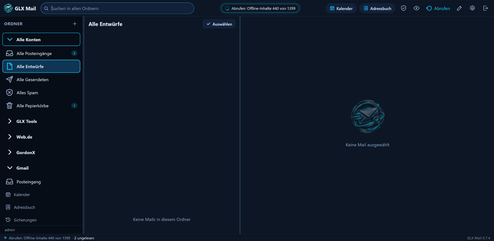
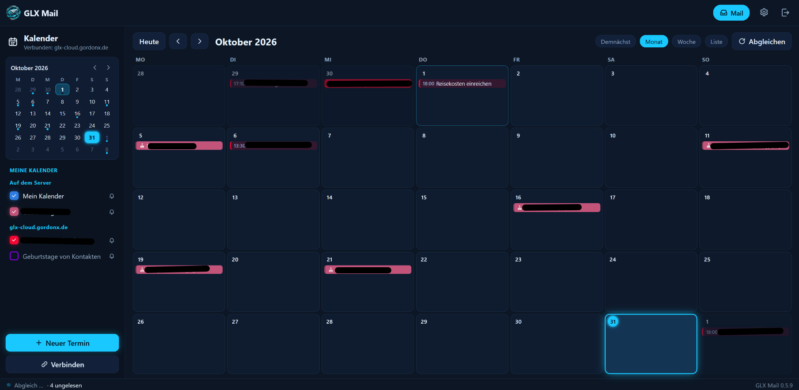

🌍 Languages: [🇺🇸 English](README.md) | [🇩🇪 Deutsch](README.de.md)

# 🖥️ GLX Mail Server

### Your own GLX Mail web application on your own server ☁️

*Self-hosted GLX Mail for users who want to operate the web application on their own Linux server. The installation can be automated with a Windows CMD tool or completed through a browser-based PHP setup page.* ⚡

---

## ⬇️ Product information & license

👉 **[GLX Tools Shop – product overview](https://glx-tools.de/shopuebersicht/)** — current product information and license options.

GLX Mail Server is intended for users who have their own Linux server and want to install and operate the GLX Mail web application themselves.

---

## 📸 Overview & Screenshots

### 1️⃣ Login View

### 2️⃣ Mail View

  

### 3️⃣ Calendar View

  

---

## ✨ Features

- ☁️ **Self-hosted:** Install GLX Mail Server on your own Linux server.
- 📮 **Web-based mail application:** Access the GLX Mail interface through your browser.
- 👥 **Address book:** Manage your contacts in the GLX Mail application.
- 📅 **Calendar:** Use the integrated calendar and manage appointments.
- 🧰 **Automated Windows installer:** A Windows CMD tool guides the installation and installs the required server components and extensions.
- 🌐 **Browser-based installation alternative:** Upload the PHP installation page and the ZIP package to your server, open the PHP page, enter the server and login details, and run the guided installation.
- 📚 **Installation instructions:** Both installation paths are documented with the distribution.

---

## 🛠️ Installation options

GLX Mail Server offers two installation paths:

### Option A — Windows CMD installation

Use the supplied Windows CMD installer. It automates the installation of GLX Mail Server and the required server extensions. Enter the requested server details when prompted and follow the installation steps.

### Option B — PHP setup page

1. Upload the supplied PHP setup page to your server.
2. Upload the GLX Mail Server ZIP package to the designated server folder.
3. Open the PHP setup page in your browser.
4. Enter the requested server and login details.
5. Follow the setup to install GLX Mail Server on your server.

Use the accompanying installation documentation for the exact folder names, prerequisites and configuration details for your server environment.

---

## 🧾 License options

GLX Mail Server is activated with a time-limited license that must be purchased again manually when you want to continue:

- **Monthly license: €2.99** — purchased manually for each month.
- **Annual license: €30.00** — purchased manually for one year.
- A reminder email is sent before the license expires.
- There is no automatic subscription renewal; the next term is purchased deliberately by the customer.

---

## 🔗 More about this product

👉 **[GLX Tools – Shop overview](https://glx-tools.de/shopuebersicht/)** — product details and license purchase.

For support: **info@glx-tools.de**

---

## 📄 License

Copyright © 2026 GLX Tools – Gordon Lehmann.
All rights reserved.

GLX Mail is proprietary commercial software.
No open-source license is granted.

The software may only be used under the
applicable license purchased through GLX Tools.

This repository contains product documentation
and screenshots. All rights to these materials
are reserved by their respective copyright holders.

GLX Mail Postfach is a hosted commercial service from GLX Tools. The applicable usage rights are defined by the license purchased through the GLX Tools shop. This repository provides product documentation and screenshots.

---

Made with ❤️ by **Dreamdancer100**

